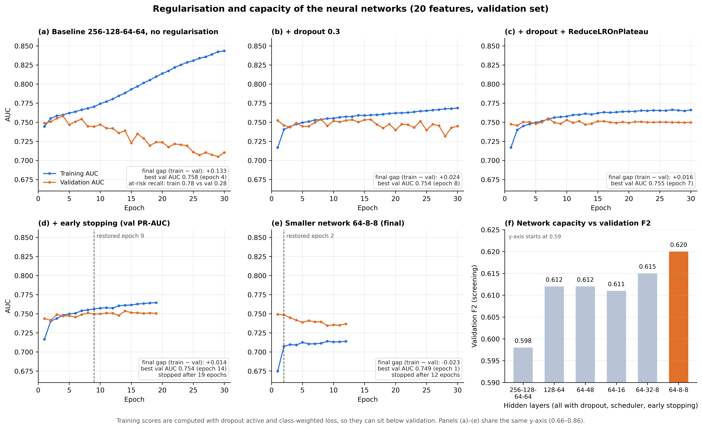
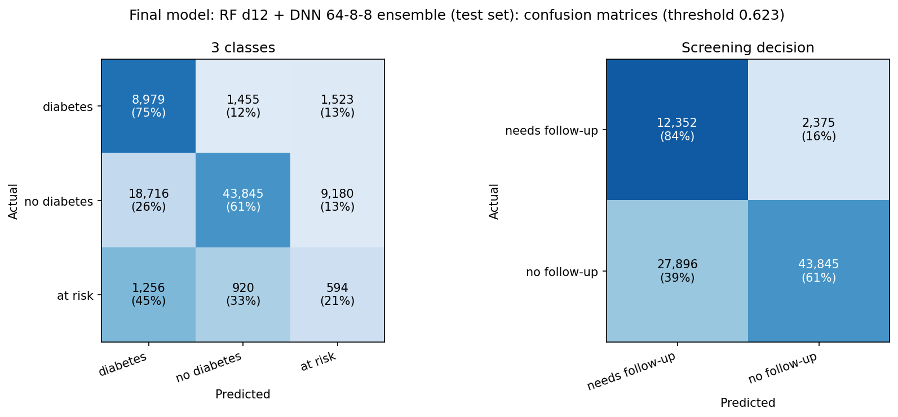
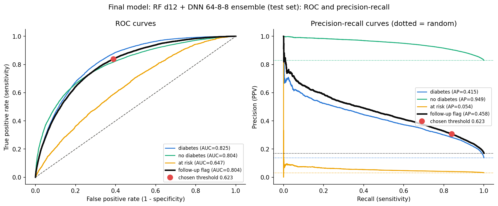

# Diabetes Screening Tool

A machine learning model that screens adults for diabetes from simple health and lifestyle questions — no blood test needed.

The tool is meant as a **first-stage triage step**: it decides who should go and get a blood test. It does not diagnose diabetes. Because missing a person with diabetes costs more than a false alarm, models are selected on **screening F2** (recall weighted four times more than precision).

**Final model (test set):** F2 0.623 · recall 0.839 · precision 0.307 · NPV 0.949 · follow-up flag ROC-AUC 0.804

---

## Contents

- [Where to get everything](#where-to-get-everything)
- [Data](#data)
- [Project structure](#project-structure)
- [How to run the project](#how-to-run-the-project)
- [What we did](#what-we-did)
- [Results](#results)
- [Limitations](#limitations)
- [Disclaimer](#disclaimer)

---

## Where to get everything

| What | Where |
|---|---|
| Code and notebooks | this repository |
| Raw dataset (`LLCP2023XPT.zip`) | [CDC BRFSS 2023](https://www.cdc.gov/brfss/annual_data/annual_2023.html) (downloaded automatically by the notebook), or the Google Drive folder below |
| Saved models, TensorBoard logs, train/val/test splits | Google Drive: **<GOOGLE_DRIVE_LINK>** |
| Result tables and figures | [`image_result/`](image_result/) |
| Variable definitions | [BRFSS 2023 codebook](https://www.cdc.gov/brfss/annual_data/2023/zip/codebook23_llcp-v2-508.zip) |

The Google Drive folder contains:

| File | Content |
|---|---|
| `final_model/random_forest_d12.joblib` | random forest (classical model) |
| `final_model/network_64_8_8.keras` and `.h5` | Keras network 64-8-8 (deep learning model) |
| `final_model/network_preprocess.joblib` | the network's imputation, scaling and one-hot encoding |
| `final_model/final_model_config.json` | ensemble weights, class order, decision threshold, feature list |
| `runs_20_features/` | TensorBoard logs of every experiment in the final notebook |
| `data/diabete_study_20_features_{train,val,test}.csv` | the exact splits used |

Raw data, splits and model files are **not** stored in this repository.

---

## Data

- **Source:** CDC Behavioral Risk Factor Surveillance System (BRFSS) 2023, a US telephone health survey
- **Size:** 433,323 respondents; 432,339 after removing unknown targets
- **Target:** `diabetes` (BRFSS `DIABETE4`), three classes

| Class | BRFSS code | Respondents | Share |
|---|---|---|---|
| No diabetes | 3 | 358,706 | 83.0% |
| Diabetes | 1 | 59,786 | 13.8% |
| At risk | 4 (prediabetes) + 2 (gestational diabetes only) | 13,847 | 3.2% |

Respondents who had diabetes only during pregnancy (code 2) are merged with prediabetes: they do not currently have diabetes, but gestational diabetes makes type 2 diabetes about ten times more likely (Vounzoulaki et al., 2020).

**Screening view:** *diabetes* or *at risk* = **flagged for follow-up**; *no diabetes* = not flagged. Base rate of flagged people: about 17%.

### Features

28 features were prepared; the final model uses **20** of them.

| Type | Final 20 features | Dropped (used only in the 28-feature notebooks) |
|---|---|---|
| Numeric | age, bmi, weight_kg, drinks_per_week, drink_occasions_per_day, exercise_minutes_per_week, strength_training_per_week | height_inches, poor_physical_health_days, poor_mental_health_days, vigorous_exercise_minutes_per_week |
| Ordinal / categorical | general_health, age_group, high_cholesterol, cholesterol_check, smoking_status | education, income |
| Binary | high_blood_pressure, sex, kidney_disease, heart_disease, difficulty_walking, physical_activity, stroke, heavy_drinker | health_insurance, cant_afford_doctor |

---

## Project structure

```
├── final_20_features.ipynb        # FINAL notebook: 20 features, all experiments, final model, test evaluation
├── experiments_28_features.ipynb  # same experiments with all 28 features (kept to show progression)
├── initial_experiment.ipynb       # first version: logistic regression, SMOTENC, random forest, LightGBM
├── image_result/                  # result tables and figures used in the report
├── requirements.txt
├── data/                          # raw XPT + train/val/test splits (created by the notebook, not tracked)
├── runs_20_features/              # TensorBoard logs of the final notebook (not tracked)
└── runs/                          # TensorBoard logs of the 28-feature notebooks (not tracked)
```

**Start with `final_20_features.ipynb`.** The two other notebooks show how the project got there.

---

## How to run the project

### Option 1: Kaggle (recommended, this is where the final notebook was run)

1. Upload `final_20_features.ipynb` to Kaggle.
2. In the notebook settings, turn on **Internet** (needed to download the data and install `tensorboardX`). A GPU is optional.
3. Click **Run All**. The 5-fold cross-validation of the classical models is the slowest part.

Outputs go to `/kaggle/working/`: `data/`, `runs_20_features/`, `final_model/` and the final figures.

### Option 2: Locally

Requires Python 3.11+ and, for the automatic download, `wget` and `unzip` (Linux, macOS or WSL).

```bash
git clone https://github.com/BodeMurairi2/diabete_screaning_tool.git
cd diabete_screaning_tool
python -m venv .venv
source .venv/bin/activate
pip install -r requirements.txt
jupyter notebook final_20_features.ipynb
```

Then run all cells. The notebook downloads the BRFSS 2023 file into `data/` the first time and skips the download afterwards. If the download fails, download `LLCP2023XPT.zip` from the CDC page or the Drive folder and unzip it into `data/` as `LLCP2023.XPT`.

> **Memory:** the full survey table needs several GB of RAM. Cross-validation and permutation importance use `n_jobs=2` to avoid running out of memory.

### Viewing the experiments in TensorBoard

The last cell of each notebook opens TensorBoard inside the notebook. From a terminal:

```bash
tensorboard --logdir runs_20_features     # final notebook (or the folder from the Drive zip)
```

Then open http://localhost:6006. Each run logs its metrics, confusion matrix, ROC/PR curves and configuration; the networks also log their learning curves.

### Using the saved final model

Download `final_model/` from the Drive folder, then:

```python
import json
import joblib
import numpy as np
import pandas as pd
from tensorflow import keras

forest = joblib.load("final_model/random_forest_d12.joblib")
network = keras.models.load_model("final_model/network_64_8_8.keras")
network_preprocess = joblib.load("final_model/network_preprocess.joblib")
config = json.load(open("final_model/final_model_config.json"))

people = pd.read_csv("data/diabete_study_20_features_test.csv")[config["features"]]   # any table with the 20 features

network_inputs = network_preprocess.transform(people)
if hasattr(network_inputs, "toarray"):
    network_inputs = network_inputs.toarray()
probabilities = 0.5 * forest.predict_proba(people) + 0.5 * network.predict(network_inputs.astype("float32"), verbose=0)

# class order [1, 3, 4] = diabetes, no diabetes, at risk
flagged = probabilities[:, 0] + probabilities[:, 2] >= config["threshold"]   # True = recommend a blood test
```

> The `.joblib` files were saved with **scikit-learn 1.6.1**, which is why `requirements.txt` pins that version. Newer versions cannot load them.

---

## What we did

### 1. Cleaning

- Kept 28 candidate features plus the target from the 350-column survey file and renamed them from BRFSS codes to readable names.
- Removed rows where the target was unknown (7 = don't know, 9 = refused, blank): 984 rows.
- Replaced BRFSS missing codes with NaN (7/9, 77/99, 14 for age group, 99900/900/99000 for drinks and strength training), and recoded 88 ("none") as 0 for the health-days questions.
- Undid BRFSS scaling (BMI, weight and drinks ÷ 100, strength training ÷ 1000) and filled 1,931 missing BMI values from height and weight.
- Capped impossible values: drinks per week at the 99.9th percentile; exercise minutes at the 95th percentile (some answers exceeded the 168 hours in a week).
- Set exercise minutes to 0 for people who reported no physical activity (BRFSS does not ask them).
- Kept "unknown" as its own category (−1) for `high_cholesterol`, because people who never had their cholesterol checked differ from those who answered no.

### 2. Encoding, split and imbalance

- Binary answers mapped to 0/1; ordinal answers re-ordered (for example, smoking: never → former → some days → daily).
- Stratified **60 / 20 / 20** split (`random_state=42`): 259,403 train / 86,468 validation / 86,468 test. The test set was used **once**, at the very end.
- Pipelines: median imputation and scaling for numeric features, most-frequent imputation and one-hot encoding for categorical features.
- Class imbalance handled with **balanced class weights** (no diabetes 0.40, diabetes 2.41, at risk 10.41). Undersampling + SMOTENC and SMOTENC to 1:1 were tested and rejected (F2 dropped to 0.53–0.56).

### 3. Feature selection (28 → 20)

Permutation importance (drop in screening F2) on logistic regression and LightGBM, combined with established clinical risk factors. Under 5-fold cross-validation the 20-feature models matched the 28-feature models (differences ≤ 0.002 F2), so the shorter questionnaire was kept.

### 4. Experiments

All runs are logged with the same function (`log_experiment`): screening F2, recall, precision, F1, specificity, NPV, per-class ROC-AUC and PR-AUC, confusion matrix, ROC/PR curves, and TensorBoard logs.

- **Classical models (scikit-learn):** logistic regression (baseline, resampling, splines, 11 features), random forest (three depths, 1,000–2,000 trees), LightGBM, XGBoost. Each scored with stratified **5-fold cross-validation** on the training set.
- **Neural networks (TensorFlow/Keras, `tf.data` pipelines):** a 256-128-64-64 baseline, then dropout 0.3, `ReduceLROnPlateau`, early stopping on validation PR-AUC, and a sweep of smaller architectures (128-64, 64-48, 64-16, 64-32-8, 64-8-8).
- **Ensembles:** soft voting (averaged probabilities) of the best classical model and the best network; a three-model version with XGBoost was also tested.
- **Decision threshold:** flag when P(diabetes) + P(at risk) ≥ threshold, chosen on the validation set by maximum F2.

---

## Results

All numbers come from `final_20_features.ipynb`. Screening metrics treat *diabetes or at risk* as positive. Tables 1–6 and all figures are in [`image_result/`](image_result/).

### 1. Classical models compared (validation set)

| Model | F2 | Recall | Precision | F1 | ROC-AUC | 5-fold CV F2 |
|---|---|---|---|---|---|---|
| Logistic regression (balanced) | 0.608 | 0.822 | 0.298 | 0.437 | 0.743 | 0.6075 ± 0.0017 |
| + undersampling + SMOTENC | 0.533 | 0.603 | 0.364 | 0.454 | 0.731 | 0.5346 ± 0.0051 |
| + SMOTENC 1:1 | 0.564 | 0.752 | 0.282 | 0.410 | 0.712 | 0.5651 ± 0.0009 |
| + splines (age, BMI) | 0.608 | 0.822 | 0.297 | 0.437 | 0.744 | 0.6072 ± 0.0016 |
| Logistic regression, 11 features | 0.610 | 0.812 | 0.305 | 0.444 | 0.740 | 0.6081 ± 0.0018 |
| Random forest, depth 6, leaf 50 | 0.609 | 0.820 | 0.300 | 0.439 | 0.746 | 0.6105 ± 0.0015 |
| **Random forest, depth 12, leaf 100** | 0.611 | 0.810 | 0.309 | 0.447 | 0.752 | **0.6122 ± 0.0014** |
| Random forest, depth 18, leaf 200 | 0.611 | 0.816 | 0.304 | 0.443 | 0.751 | 0.6116 ± 0.0012 |
| LightGBM | 0.611 | 0.803 | 0.312 | 0.449 | 0.750 | 0.6082 ± 0.0019 |
| XGBoost, depth 4 | 0.611 | 0.834 | 0.295 | 0.436 | 0.752 | 0.6098 ± 0.0009 |

- All classical models landed in a narrow band (F2 0.608–0.611). Tree models were barely better than logistic regression, so the relationship between survey answers and diabetes is mostly additive.
- Resampling with SMOTENC hurt; balanced class weights worked better.
- The **depth-12 random forest** had the best cross-validated F2 and was kept as the classical model (1,000 trees; 2,000 trees gave no gain).

### 2. Neural networks (validation set)

| Network | F2 | Recall | Precision | F1 | ROC-AUC |
|---|---|---|---|---|---|
| 256-128-64-64 baseline | 0.592 | 0.807 | 0.287 | 0.423 | 0.712 |
| + dropout 0.3 | 0.608 | 0.840 | 0.289 | 0.430 | 0.745 |
| + ReduceLROnPlateau | 0.605 | 0.839 | 0.286 | 0.427 | 0.750 |
| + early stopping | 0.598 | 0.823 | 0.286 | 0.424 | 0.750 |
| 128-64 | 0.612 | 0.830 | 0.299 | 0.439 | 0.753 |
| 64-48 | 0.612 | 0.829 | 0.299 | 0.440 | 0.752 |
| 64-16 | 0.611 | 0.835 | 0.294 | 0.435 | 0.752 |
| 64-32-8 | 0.615 | 0.840 | 0.297 | 0.439 | 0.750 |
| **64-8-8** | **0.620** | **0.853** | 0.296 | 0.440 | 0.749 |

The networks from 128-64 down use dropout 0.3, `ReduceLROnPlateau` and early stopping.

- The unregularised baseline overfitted quickly: training AUC rose from 0.744 to 0.843 while validation AUC peaked at 0.758 (epoch 4) and fell to 0.710.
- Dropout cut the train–validation gap from 0.133 to 0.024, and the scheduler to 0.016.
- **Smaller networks did better than larger ones.** The 64-8-8 network had the highest F2 and recall of any single model (it restored epoch 2).



### 3. Classical model vs neural network (test set)

| Metric | Random forest (depth 12) | Network 64-8-8 |
|---|---|---|
| F2 | 0.614 | **0.620** |
| Recall | 0.815 | **0.853** |
| Precision | **0.309** | 0.296 |
| F1 | **0.448** | 0.439 |
| ROC-AUC (3-class) | **0.756** | 0.749 |
| PR-AUC, diabetes | 0.411 | **0.413** |
| PR-AUC, at risk | **0.053** | 0.052 |
| NPV | 0.943 | **0.951** |
| Diabetics missed | 15.3% | **10.8%** |

The two approaches perform almost the same. The network catches more cases at the cost of more false alarms; the forest is more precise, ranks people slightly better and is more stable (cross-validation std 0.0014). The network also needed dropout, a scheduler and early stopping to stop overfitting.

### 4. Ensemble and decision threshold

The forest and the network were combined by **averaging their predicted probabilities** (equal weights). Adding XGBoost as a third member did not help, so the two-model ensemble was kept.

| Decision rule | Set | Threshold | F2 | Recall | Precision | F1 | NPV | Flagged |
|---|---|---|---|---|---|---|---|---|
| Most likely class | validation | — | 0.618 | 0.820 | 0.312 | 0.452 | 0.945 | 44.8% |
| **Max F2** | validation | 0.6233 | **0.625** | 0.840 | 0.309 | 0.451 | 0.949 | 46.3% |
| Recall ≥ 0.85 | validation | 0.613 | 0.624 | 0.850 | 0.302 | 0.446 | 0.951 | 47.9% |
| Most likely class | test | — | 0.618 | 0.820 | 0.311 | 0.451 | 0.944 | 44.9% |
| **Max F2 (final)** | test | 0.6233 | **0.623** | 0.839 | 0.307 | 0.449 | 0.949 | 46.5% |
| Recall ≥ 0.85 | test | 0.613 | 0.622 | 0.850 | 0.301 | 0.444 | 0.951 | 48.2% |

Both thresholds were chosen on the validation set only; validation and test results match closely.

### 5. Final model

**Soft-voting ensemble of the depth-12 random forest and the 64-8-8 network, 20 features, flag when P(diabetes) + P(at risk) ≥ 0.6233.**

| Metric (test set, n = 86,468) | Value |
|---|---|
| F2 | **0.623** (validation 0.625) |
| Recall (sensitivity) | 0.839 |
| Precision (PPV) | 0.307 |
| F1 | 0.449 |
| NPV | 0.949 |
| People flagged | 46.5% |
| Diabetics missed | 12.2% |
| ROC-AUC, follow-up flag | 0.804 |
| PR-AUC, follow-up flag (base rate ≈ 0.17) | 0.458 |
| ROC-AUC, 3-class one-vs-rest | 0.759 |
| PR-AUC, diabetes / at risk | 0.415 / 0.054 |

In plain terms:

- A **"low risk"** answer is correct about **95%** of the time.
- A **"get tested"** answer is correct about **31%** of the time, against a 17% base rate (about 1.8× better than chance).
- 84% of people with diabetes or at risk are flagged.




### Key takeaways

1. **Every model hit the same ceiling** (F2 ≈ 0.61–0.62, ROC-AUC ≈ 0.75). Survey answers carry limited information; better data would help more than a bigger model.
2. **Regularisation and smaller networks mattered more than depth.**
3. **Balanced class weights beat resampling** for this imbalance.
4. **Combining a forest and a network** and tuning the decision threshold gave the best and most balanced result.

---

## Limitations

- **Self-reported labels:** people with undiagnosed diabetes are labelled "no diabetes", so some false alarms may be real cases.
- **Weak "at risk" class:** PR-AUC 0.054 against a 0.032 base rate; most of the screening value comes from the diabetes class.
- **Low precision:** about 46% of people are flagged, which means many unnecessary blood tests.
- **One split, one seed for the networks:** they were not cross-validated, so small differences between architectures may be noise.
- **No survey weights, no probability calibration, no external validation** (for example on lab-confirmed data), and no fairness check by subgroup.

---

## Disclaimer

This tool is for educational and research purposes only. It does not replace a medical diagnosis. Anyone concerned about diabetes should see a healthcare professional and get a blood test.

## Reference

Vounzoulaki E, Khunti K, Abner SC, Tan BK, Davies MJ, Gillies CL. Progression to type 2 diabetes in women with a known history of gestational diabetes: systematic review and meta-analysis. *BMJ*. 2020;369:m1361.
